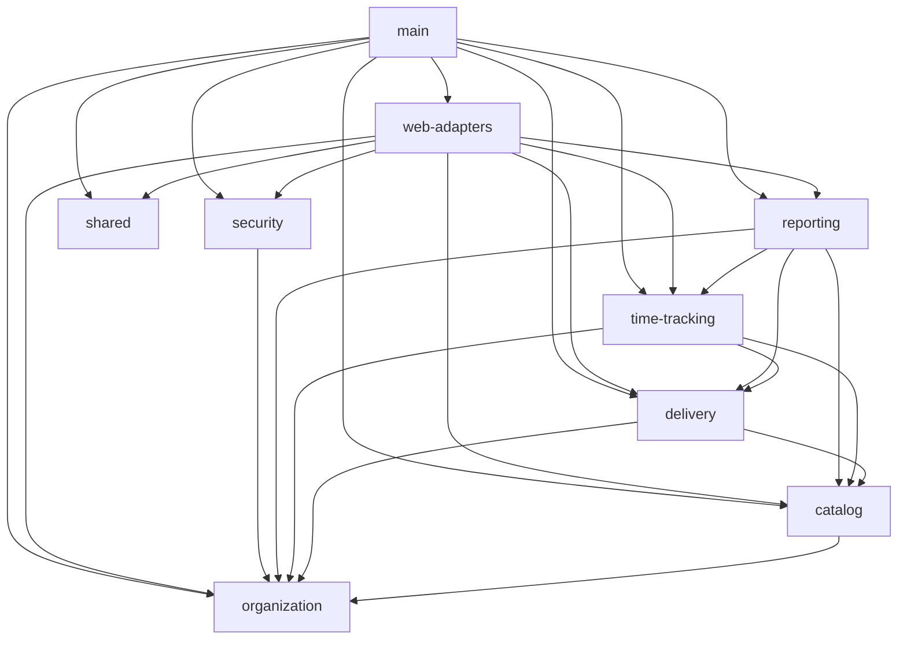
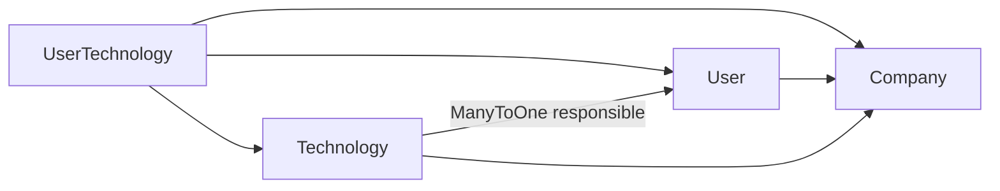
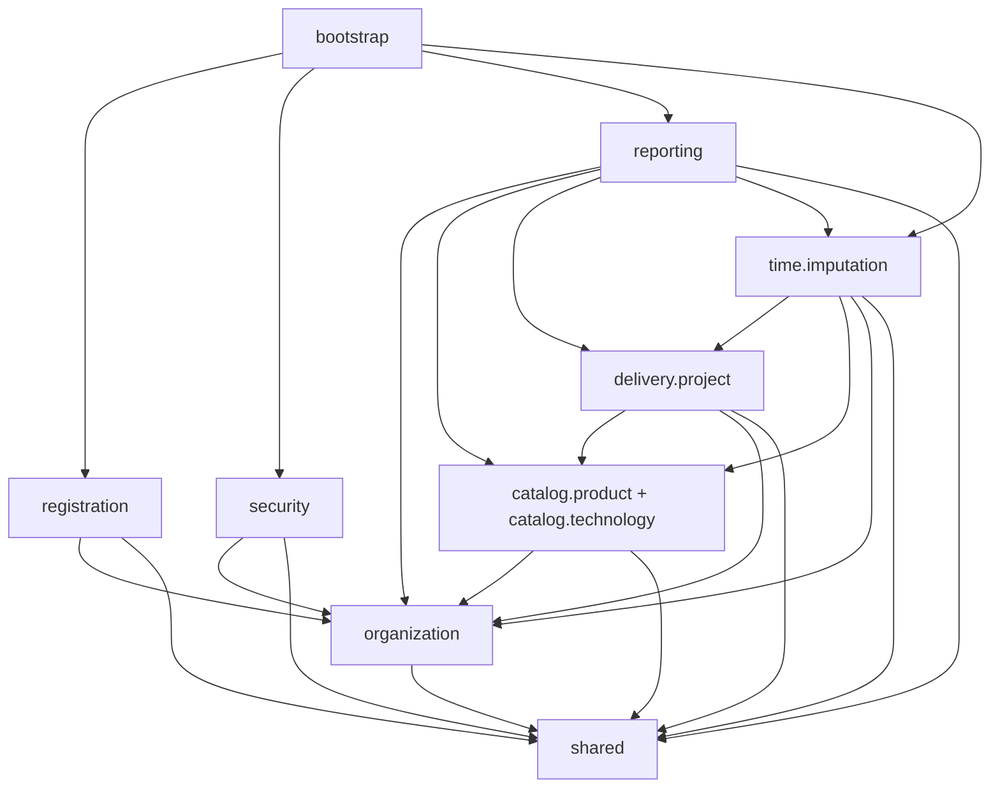

# Arquitectura objetivo del backend

Estado actualizado: 2026-10-03.

## Estado de la extracción

La reorganización por paquetes y capacidades, incluida la extracción Maven del paso 5 y la optimización de lecturas de fase 6, está completada. El reactor activo contiene `organization`, `catalog`, `delivery`, `time-tracking`, `reporting`, `security`, `web-adapters`, `shared` y el ejecutable `main`. Los módulos técnicos vacíos (`entities`, `repositories`, `services`, `controllers`, `auth`, `error`, `util`) fueron retirados. Se conservaron las tablas y respuestas HTTP existentes; las rutas paginadas nuevas son aditivas.

## Grafo Maven actual



`shared` contiene únicamente contratos y errores técnicos reutilizados. `main` conserva el nombre y el artefacto ejecutable; `web-adapters` compone las APIs de las capacidades. No quedan declaraciones Maven de los módulos retirados.

## Capacidades funcionales objetivo

| Capacidad | Responsabilidad | Código actual que posee |
|---|---|---|
| `organization.company` | Empresa cliente y límite de aislamiento | `Company`, `CompanyRepository`, `CompanyService` |
| `organization.user` | Usuarios, roles, perfil y administración | `User`, `Role`, contratos, repositorios, servicios y puerto `UserTechnologyAssignments` |
| `catalog.technology` | Catálogo de tecnologías, responsable y asociación de tecnologías a usuarios | `Technology`, `UserTechnology`, contratos, repositorios, servicio, adaptador de asignaciones y controlador |
| `catalog.product` | Productos, responsable, backup y tecnología | `Product`, contratos, repositorio, servicio y controlador de producto |
| `delivery.project` | Proyectos, fechas, producto, responsable y colaboradores | `Project`, contratos, repositorio, servicio y controlador de proyecto |
| `time.imputation` | Imputaciones diarias e ítems de tiempo | `Imputation`, `ImputationItem`, contratos, repositorio, servicio y controlador |
| `registration` | Alta coordinada de empresa y primer administrador | `AuthController`, `RegisterRequest` |
| `security` | Login JWT, validación, usuario/empresa actuales | filtros JWT, `SpringSecurityConfig`, `JwtService`, `CurrentUserContext`, `JpaUserDetailsService` |
| `reporting` | Consultas y read models con métricas entre dominios | proyecciones agregadas, consultas de métricas y ensamblado de resúmenes |
| `shared` | Contratos técnicos sin lógica de negocio | `PageResponse`, errores HTTP y factoría de errores |
| `bootstrap` | Arranque, perfiles, Flyway y ensamblado | `Main`, `application*.properties`, migraciones |

## Relaciones de usuario y tecnología

La relación JPA se mantiene mediante la entidad puente, pero ya no crea un ciclo de tipos entre los dominios:



`User` no declara una navegación inversa a `UserTechnology` ni importa `Technology`. `organization.user` define el puerto `UserTechnologyAssignments` y el contrato local `UserTechnologyResponse`; `catalog.technology` implementa el puerto, resuelve los IDs dentro de la compañía y gestiona `UserTechnology`. `Technology` conserva la referencia a su usuario responsable, por lo que la dependencia de dominio va de catálogo hacia organización, nunca al revés. No hay ciclo de tipos entre esas capacidades.

## Grafo funcional objetivo

Las flechas significan "puede depender de".



### Relaciones del modelo que justifican el grafo

- `User` pertenece a `Company`; `UserTechnology` enlaza usuario y tecnología en `users_technologies`, con validación JPA y claves foráneas compuestas por compañía. `catalog.technology` implementa el puerto de asignaciones definido por `organization.user`.
- `Technology` pertenece a `Company` y referencia un `User` responsable; su modelo y casos de uso están en `catalog.technology`.
- `Product` pertenece a `Company` y referencia `Technology`, responsable y backup.
- `Project` pertenece a `Company` y referencia `Product`, responsable y colaboradores.
- `Imputation` referencia `User`; cada `ImputationItem` referencia `Project`.
- Las consultas de métricas recorren varios dominios y por eso pertenecen a `reporting`, no al núcleo de `technology`, `product` o `project`.

## Estructura de paquetes por módulo

Los módulos Maven activos expresan ahora las capacidades y responsabilidades descritas a continuación. Las rutas reflejan paquetes Java, no módulos técnicos separados.

```text
com.arinno.canopus
├── organization
│   ├── company
│   │   ├── api
│   │   ├── application
│   │   ├── domain
│   │   ├── contract
│   │   └── infrastructure.persistence
│   └── user
│   │   ├── api
│   │   ├── application
│   │   ├── domain
│   │   ├── contract
│   │   └── infrastructure.persistence
├── catalog.product
│   ├── api
│   ├── application
│   ├── domain
│   ├── contract
│   └── infrastructure.persistence
├── catalog.technology
│   ├── api
│   ├── application
│   ├── domain
│   ├── contract
│   └── infrastructure.persistence
├── delivery.project
│   ├── api
│   ├── application
│   ├── domain
│   ├── contract
│   └── infrastructure.persistence
├── time.imputation
│   ├── api
│   ├── application
│   ├── domain
│   ├── contract
│   └── infrastructure.persistence
├── reporting
│   ├── application
│   ├── contract
│   └── infrastructure.persistence
├── registration.api
├── security
├── shared
│   ├── contract
│   └── error
└── bootstrap
```

### Distribución física anterior a la extracción Maven

La tabla y el ejemplo siguientes describen el estado transitorio previo al paso 5; se conservan sólo como referencia histórica.

| Módulo técnico anterior | Sufijos de paquete que contenía |
|---|---|
| `entities` | `*.domain`, `*.contract`, `shared.contract` |
| `repositories` | `*.infrastructure.persistence` |
| `services` | `*.application`, servicios de `security` |
| `controllers` | `*.api`, mapeadores de contrato y `registration.api` |
| `auth` | filtros y configuración de `security` |
| `error` | `shared.error` |
| `main` | `bootstrap` |

Una misma capacidad quedaba distribuida físicamente entre módulos técnicos, aunque compartía una raíz de paquete reconocible. Ejemplo anterior:

```text
entities/.../catalog/product/domain/Product.java
entities/.../catalog/product/contract/ProductRequest.java
repositories/.../catalog/product/infrastructure/persistence/ProductRepository.java
services/.../catalog/product/application/ProductService.java
controllers/.../catalog/product/api/ProductController.java
```

## Reglas de dependencia

1. `api` llama a `application`; no accede directamente a repositorios.
2. `application` coordina casos de uso y usa repositorios o servicios de capacidades inferiores.
3. `domain` no importa controladores, mapeadores, DTOs HTTP ni configuración Spring Security.
4. `infrastructure.persistence` implementa acceso a datos y puede importar el modelo `domain` que persiste.
5. Los comandos HTTP reciben DTOs de `contract`; nunca entidades JPA directamente.
6. Toda relación recibida por ID se resuelve dentro de la compañía autenticada antes de persistirse.
7. `shared` no contiene entidades ni reglas específicas de un dominio.
8. `security` puede resolver identidad y compañía, pero no consultar productos, proyectos ni imputaciones.
9. Las métricas que combinan dominios se implementan como consultas/read models en `reporting`; los mapeadores no deben ejecutar varias consultas por elemento.
10. Ninguna capacidad inferior depende de una superior: `organization` no importa `catalog`, `delivery` ni `time`.
11. No se crea un nuevo módulo Maven si introduce una dependencia circular.
12. Cada movimiento de paquete debe mantener compilación, tests, integración HTTP y construcción del JAR en verde.

## Estado de los bloqueos de extracción

| Acoplamiento observado | Estado | Implicación para Maven |
|---|---|---|
| Dependencias de producción heredadas desde el POM raíz | Resuelto en fase 1: el parent gestiona versiones y cada módulo declara sus dependencias. | La compilación ya no recibe librerías accidentalmente desde el parent. |
| `TechnologyMapper`, `ProductMapper`, `ProjectMapper` y `UserMapper` consultaban varios servicios | Resuelto en fase 2: son transformadores puros; reciben métricas de `ReportingService`. | Los mappers permanecen en `application/web-adapters`, que puede depender de reporting y de las capacidades. |
| Agregados de imputación por proyecto/producto/tecnología dentro de `ImputationRepository` | Resuelto en fase 2: las consultas transversales viven en `ReportingRepository`; `IImputationService` queda con operaciones propias de tiempo. | `reporting` depende de las capacidades; `time-tracking` no necesita depender de reporting. |
| Métricas todavía se calculaban por entidad desde `ReportingService` | Resuelto en fase 6 con consultas agrupadas para usuarios, productos, proyectos y tecnologías. | El número de consultas es constante por página, no por elemento; el contrato de métricas no cambia. |
| Código fuente seguía físicamente distribuido en módulos técnicos | Resuelto en fases 3-5: movido a módulos de capacidad y soporte. | El reactor y el JAR usan los nuevos módulos sin referencias a los módulos técnicos retirados. |
| Módulos técnicos vacíos y dependencias POM asociadas | Resuelto en fase 5: POMs y referencias retirados; error y contratos genéricos viven en `shared`. | Auditoría POM, `clean verify` (27 tests), Angular, JAR y health `UP` pasan. |

## Resultado del paso 5: módulos Maven

Se extrajeron módulos por capacidad, no uno por paquete. El grafo activo y acíclico mantiene controllers/mappers transversales en `web-adapters` y el arranque en `main`.

```mermaid
graph TD
    sharedM[shared]
    organizationM[organization]
    catalogM["catalog (technology + product)"]
    deliveryM[delivery]
    timeM[time-tracking]
    reportingM[reporting]
    securityM[security]
    webM["application / web adapters"]
    appM[bootstrap]

    organizationM --> sharedM
    catalogM --> organizationM
    catalogM --> sharedM
    deliveryM --> catalogM
    deliveryM --> organizationM
    deliveryM --> sharedM
    timeM --> deliveryM
    timeM --> catalogM
    timeM --> organizationM
    timeM --> sharedM
    reportingM --> organizationM
    reportingM --> catalogM
    reportingM --> deliveryM
    reportingM --> timeM
    securityM --> organizationM
    securityM --> sharedM
    webM --> organizationM
    webM --> catalogM
    webM --> deliveryM
    webM --> timeM
    webM --> reportingM
    webM --> securityM
    webM --> sharedM
    appM --> webM
    appM --> sharedM
```



### Estado por módulo

| Módulo | Estado | Responsabilidad y dependencias principales |
|---|---|---|
| `organization` | Extraído | `company`, `user`, `role` y puerto de asignaciones; no depende de catálogo. |
| `catalog` | Extraído | `technology` y `product`; depende de `organization`. |
| `delivery` | Extraído | Proyectos; depende de `catalog` y `organization`. |
| `time-tracking` | Extraído | Imputaciones; depende de `delivery`, `catalog` y `organization`. |
| `reporting` | Extraído | Consultas y read models transversales; depende de las capacidades. Las métricas de listas se recuperan por lote desde fase 6. |
| `security` | Extraído | JWT, filtros y usuario actual; depende de `organization`. |
| `web-adapters` | Extraído | Controllers, mappers HTTP y registro; compone módulos inferiores. |
| `shared` | Extraído | Contratos técnicos y errores compartidos; sin entidades ni lógica de negocio. |
| `main` | Conservado como ejecutable | Ensambla la aplicación, configuración y Flyway; preserva el nombre y la convención del JAR. |
| `registration` | No es módulo independiente | `POST /register` permanece como orquestación en web-adapters. |

### Gates completados y siguiente fase

1. Los módulos técnicos vacíos (`entities`, `repositories`, `services`, `controllers`, `auth`, `error`, `util`) y sus dependencias POM se retiraron.
2. La auditoría no encontró declaraciones de módulos o artefactos retirados en los POMs activos.
3. `mvnw.cmd -q clean verify` pasó con 27 tests, 0 fallos y 0 errores; `npm run build` pasó.
4. El JAR contiene los módulos nuevos, arranca con MySQL/Flyway y `/actuator/health` devuelve `UP`.
5. Fase 6 completada: paginación server-side para las listas principales, métricas por lote y carga anticipada de relaciones; se conservan las rutas array existentes.

## Historial de reorganización por paquetes

1. Crear raíces `shared` y `organization.company` y mover contratos técnicos/empresa.
2. Mover `organization.user` y extraer `catalog.technology` con un puerto de asignaciones para mantener la dependencia unidireccional.
3. Mover `catalog.product`.
4. Mover `delivery.project`.
5. Mover `time.imputation`.
6. Separar consultas transversales bajo `reporting` (hecho en fase 2).
7. Mover autenticación a `security` y registro a `registration`.
8. Mover `Main` y configuración conceptual a `bootstrap`.
9. Retirar los módulos técnicos vacíos y sus dependencias en el paso 5 (hecho).
10. Validar tests, build frontend, empaquetado y arranque local después de cada bloque (hecho para la extracción).

## Criterios de aceptación

- Cada clase activa tiene una capacidad propietaria clara.
- El grafo objetivo no contiene ciclos entre capacidades de nivel superior; `catalog.technology` depende de `organization` para usuario, compañía y el puerto de asignaciones.
- Las reglas de dependencia están documentadas y pueden verificarse mediante imports.
- Las dependencias entre módulos Maven activos forman un grafo acíclico.
- Los contratos HTTP y el esquema se conservaron durante la extracción.
- Las listas principales tienen límites de página y las consultas de métricas no ejecutan una consulta por elemento.
